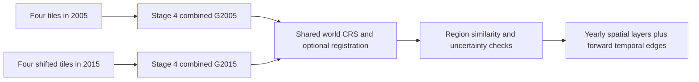

# Stage 5: yearly combined graphs to a spatiotemporal graph

## Meaning of a yearly graph

The input at each year is **one complete Stage 4 combined graph**. For example,
combine four tiles from 2005 into G2005, combine four tiles from 2015 into G2015,
then pass these two combined graphs to Stage 5. Stage 5 does not compare tile
number 0 with tile number 0. A tile index, instance index, or local pixel position
does not establish identity across different source rasters.

Equal tile counts are allowed but not required. Equal counts do not imply equal
ground coverage. Each year can contain a different number of segmented nodes.

For each G_t = (V_t, E_t), Stage 5 creates a distinct observation (v,t) for each
node. The output contains the disjoint union of yearly observations, every
original spatial edge, and directed temporal edges between adjacent observed
years. A ten-year gap is recorded as ten years, not one timestep of elapsed time.



## Coordinates: three distinct frames

1. Tile pixels: Stage 4 has already added the tile offsets and reconciled overlaps.
2. Source-image pixels: `geometry_source_pixel` is relative to that year's raster.
3. World coordinates: apply that raster's affine, then reproject to a common CRS.

The repository stores Rasterio/Affine coefficients **[a,b,c,d,e,f]**:

```text
X = a*x + b*y + c
Y = d*x + e*y + f
```

This is not GDAL's serialized coefficient order. Polygon vertices locate pixel
edges; do not add another half pixel or tile offset to them. Rotation, shear,
negative north-up y resolution, different pixel sizes, and different source CRSs
are supported. Long pixel segments are densified to at most eight source-pixel
units before nonlinear reprojection. The affine convention follows the
[GDAL coordinate model](https://gdal.org/en/stable/tutorials/geotransforms_tut.html),
with reprojection performed through
[Rasterio](https://rasterio.readthedocs.io/en/stable/api/rasterio.warp.html).

Matching uses a **projected metre CRS**, never degrees. The default is the first
year's projected metre CRS. If that CRS is geographic or in feet, supply an
appropriate projected metre `target_crs`, usually the local UTM zone. Choose a
projection suitable for the study area; an arbitrary projected CRS can distort
measurements. CRS transformations preserve the datum transformations available
in the installed PROJ environment; they do not establish survey-grade accuracy.

Missing CRS or affine metadata is an error. An explicitly supplied, verified
`georeference` can override `crs` and `source_affine_transform` on a snapshot;
the override is recorded. Arbitrary pixel offsets cannot recover absolute
geolocation. WGS84 GeoJSON is exported for GIS interchange; its coordinate
order is longitude, latitude. JSON world geometry and numeric arrays remain in
the declared projected CRS.

## Registration is separate from matching

Shifted tile boundaries are handled by world conversion. Residual image
misregistration requires additional evidence. Three input modes are available:

| Mode | Implemented behavior | Limitation |
|---|---|---|
| Georeference only, default | Apply each affine and CRS | Records that registration accuracy is unverified |
| Supplied control points | RANSAC affine moving-world to reference-world | Points must be in the common metre CRS |
| `register_to_reference: true` | Mutual SIFT ratio matches from georeferenced rasters, then RANSAC | Requires reference and moving `image_path`; global affine only |

All later years register directly to the earliest reference year to avoid
accumulating pairwise registration drift. Do not supply annotated graph previews
as registration images. `image_path` must be a georeferenced raster covering the
study area in the same geolocation as its graph.

SIFT reads a downsampled image bounded to 2048 pixels on its longest side and
extracts at most 6000 keypoints. Keypoints are converted back to source-pixel
centres and then to the common CRS. Mutual matches must pass a 0.75 descriptor
ratio. RANSAC requires at least six distinct, non-collinear inliers in each
coordinate frame. The default minimum inlier fraction is 0.5; configurable
fractions must be in (0,1]. The inlier-count floor cannot be lowered below six.
Residual thresholds must be finite and positive; the default is 2 m.
Fits with reflection or singular
values outside [0.8,1.25] are rejected. The intersection of the inlier control-point
hull with the selected graph must cover at least 5% of its observed area.
These are engineering checks, not calibrated
accuracy guarantees. Fit residuals are in-sample: independently surveyed or
held-out stable landmarks are needed to measure registration error.

For an externally generated match set, add this to the later snapshot:

```json
"registration": {
  "moving_xy": [[500000,3700000], [500100,3700000], [500000,3700100],
                [500100,3700100], [500050,3700030], [500020,3700080]],
  "reference_xy": [[500002,3699999], [500102,3699999], [500002,3700099],
                   [500102,3700099], [500052,3700029], [500022,3700079]],
  "max_residual_m": 2.0
}
```

This example illustrates the format, not control points for the local IKONOS
data. Real points can come from surveyed landmarks or a validated feature matcher.

## Correspondence and similarity

Coverage for a year is the union of its observed region polygons, retaining
holes and gaps. The common coverage is the intersection of the two yearly
unions. Node geometries are clipped to that common coverage **for matching
only**. Full geometries remain in the output. This prevents a different tile
extent from automatically looking like object growth or disappearance.

A Shapely STRtree retrieves nearby candidates. Its default search buffer is 5 m;
positive overlap is still required for an accepted temporal correspondence.
Nearby but disjoint lookalikes are not automatically linked. For visible
polygons A and B, the implemented score is:

```text
I = area(A intersection B) / area(A union B)
D = exp(-centroid_distance / max(search_radius, sqrt(min(area(A),area(B)))))
A_sim = min(area(A),area(B)) / max(area(A),area(B))
compactness(P) = 4*pi*area(P) / perimeter(P)^2
H = min(compactness(A),compactness(B)) / max(compactness(A),compactness(B))
N_distribution = 1 - 0.5 * L1(normalized_neighbor_class_histogram_A,
                              normalized_neighbor_class_histogram_B)
N_cosine = cosine(neighbor_class_counts_A, neighbor_class_counts_B)
N = 0.5 * (N_distribution + N_cosine)
S = 0.55*I + 0.15*D + 0.10*A_sim + 0.10*H + 0.10*N
```

Missing neighborhood information contributes a neutral 0.5. Neighborhoods come
from the full original spatial graphs. Context near the footprint boundary can
therefore be incomplete; its weight is intentionally small. Same semantic class
is **not** required: agriculture can become a building region. RGB similarity is
not used because seasonal/illumination differences can dominate it and Stage 4
does not currently carry normalized appearance descriptors.

Default one-to-one acceptance requires IoU >= 0.20 and S >= 0.60, plus a margin
>= 0.05 over other IoU-eligible candidates at **both endpoints**, including
alternatives below the score threshold. Ambiguous
ties remain unresolved. Eligible components use a maximum-benefit linear
assignment with zero-benefit dummy unmatched choices. The conservative margin
gate typically leaves singleton components; this is not a global quadratic
graph-matching solver. The assignment uses SciPy's
[modified Jonker–Volgenant implementation](https://docs.scipy.org/doc/scipy/reference/generated/scipy.optimize.linear_sum_assignment.html).

After the main assignment, a conservative second pass uses already accepted,
stable building pairs as local coordinate landmarks. It requires at least four
such pairs globally and three within 125 m of a candidate. The local median
residual offset must be at most 8 m and consistent among the landmarks. An
unresolved **same-class** pair can then be rescued only if it has raw overlap,
adjusted IoU at least 0.35, a plausible area ratio, a sufficiently small
centroid residual, and a unique best rescue score. The offset is used to
compare polygons; it does not alter their stored coordinates. The audit under
`matching_refinement.coordinate_rescue` reports its anchor and recovery counts.
Merged or extremely large building masks can remain unresolved when they lack
a unique counterpart.

All nearby candidate scores and rejection reasons are retained under
`comparisons[].candidates`; accepted temporal edges retain their evidence. Scores
are deterministic heuristics, **not calibrated probabilities**. `track_id` means
an inferred region-correspondence chain. It does not prove persistence of a
physical building or tree at that location.

## Splits, merges, and change

Before one-to-one assignment, strong-overlap components are examined for clear
one-to-many splits and many-to-one merges. Each branch must cover >= 80% of its
child/smaller side and >= 10% of the parent side, and the children collectively
must cover >= 80% of the parent. These links describe region lineage. Children
of a split and the result of a merge get new tracks. Many-to-many resegmentation
without clear correspondence is allowed to remain unresolved.

For each temporal edge, Stage 5 records class transition, visible-geometry
change `1-IoU`, elapsed years, and (for sufficiently visible one-to-one links)
full world-area delta and relative area change. If either region has < 90%
visibility, full-area change is `null`. Split/merge pairwise area deltas are also
`null`, because comparing one whole parent to one child would mislead. Unknown
class ID 8 yields `semantic_changed: null`.

Unmatched identity observations are marked `outside_common_coverage`,
`partial_coverage`, or `unresolved`. Identity matching alone does not declare
birth/death. The separate class-change layer below tests presence and absence
against observed land cover, including nodes without identity correspondences.
Persistent unchanged regions still receive temporal correspondence edges.

## Class-specific change edges (schema v2)

The graph contains three forward temporal edge collections:

- `temporal_edges`: correspondence, split, and merge relationships.
- `change_edges`: explicit events, each referring to one `change_events` record.
- `semantic_temporal_edges`: the public class-specific outcome layer, with at
  most one edge per old/new node pair. Examples are `building_constructed`,
  `building_demolished`, `road_removed`, `water_lost`, and
  `tree_cover_unchanged`.

The public PNGs render `semantic_temporal_edges` only. Same-year adjacency and
raw matcher lineage are retained in `graph.json` for audit, but are not shown
as cross-year outcome types. Every semantic edge includes `class_id`,
`class_name`, `relation`, `status`, the supporting change-event IDs, and the
matching-edge ID when present. If a pair supports both an old-class loss and a
new-class gain, the public layer selects the more specific class outcome (for
example, bareland to building becomes `building_constructed`); both source
events remain in `change_events`. A same-class matched pair is labeled
`<class>_unchanged` only if overlap IoU is at least 0.5 and area differs by at
most 10%, with no detected physical change event. Unknown, weakly supported,
and ambiguous pairs are omitted rather than given a misleading label. These
are candidate mapped outcomes, not confirmed physical causes.

Each event carries a `class_id`, `class_name`, `relation`, geographic geometry,
before/after node IDs, measurements, evidence, and status. The same endpoint
pair can support multiple events: agriculture disappearing and a building being
constructed are different class interpretations of the same changed ground.
`change_event_count` counts events, `change_edge_count` counts supporting links,
`all_temporal_edge_count` adds raw correspondence and change links, and
`semantic_temporal_edge_count` counts the public one-per-pair outcomes. Existing v1
graphs remain loadable; new exports use `satellitegraph.stage5.spatiotemporal-graph.v2`.

### Vocabulary for all nine classes

| ID / class | Entire region appears | Entire region disappears | Continuing extent |
|---|---|---|---|
| 0 bareland | `appeared` | `disappeared` | `expanded`, `contracted`, `reconfigured` |
| 1 rangeland | `appeared` | `disappeared` | same three extent relations |
| 2 developed space | `appeared` | `disappeared` | same three extent relations |
| 3 road | `constructed` | `removed` | same three extent relations |
| 4 tree | `appeared` | `disappeared` | same three extent relations |
| 5 water | `appeared` | `disappeared` | same three extent relations |
| 6 agriculture land | `appeared` | `disappeared` | same three extent relations |
| 7 buildings | `constructed` | `demolished` | same three extent relations |
| 8 unknown | no physical event | no physical event | no change edge |

Names describe mapped observations. New tree cover does not prove planting;
tree loss does not establish logging. Agriculture transitions do not establish
crop yield or abandonment. Developed space includes more than buildings, so its
loss is not automatically called demolition. Road footprint growth can mean
extension, widening, changed extraction, or several of these; no centreline
length/width distinction is claimed. Building footprint changes do not reveal
height. Water gain/loss is between observed dates; two images cannot establish
permanence, flood, drought, or seasonal behavior.

### Edge placement and evidence for absence

Class-change detection overlays every geographically intersecting before/after
polygon, independently of the identity IoU gate. Thus a small building emerging
inside a large field can receive a `constructed` edge even if their identity
similarity is low. Its endpoints are **the previous field node and the new
building node**. Demolition connects the earlier building to observed replacement
land cover. No invented absence node or nonexistent endpoint is introduced.

An unmatched node is not sufficient evidence of absence. The whole-region
assessment requires at least 95% common observed coverage, and at least 95% of
the tested change area must have reliable known labels in both years. Each
class-group member must also have semantic confidence >= 0.60. Missing/non-finite
confidence cannot establish a physical event. Classifier scores themselves are
not calibrated physical-change probabilities.

Unknown transitions do not produce change events or change edges. They remain
visible as class-8 yearly nodes and may have uncertain correspondence links.
A building replaced partly by unknown pixels may therefore remain
`insufficient_semantic_evidence`; this is deliberate abstention. Clouds
mislabeled as confident known classes remain
an upstream limitation; this module cannot infer an unavailable cloud mask.

If a small uncertain portion is tolerated by `minimum_known_fraction`, physical
event geometry, supporting edges and `gain_area_m2`/`loss_area_m2` are still
restricted to reliable known observations. `raw_gain_area_m2`, `raw_loss_area_m2`
and `unassessed_change_area_m2` disclose the remaining extent. For example,
960 m² known replacement and 40 m² unknown may support a candidate demolition
event on 960 m²; the unknown 40 m² never receives a demolition edge. Set
`minimum_known_fraction: 1.0` to require fully known evidence.

### Area and segmentation changes

For each known class, connect overlapping same-class observations across years
and compare the **unions** in each connected group. A pure one-to-two segmentation
split or two-to-one merge has unchanged union area, so it produces no physical
change edge; a valid local split/merge may still have structural links. This does not establish
individual physical-object identity inside the group.

Let A and B be those unions clipped to common observed ground:

```text
raw gain = B minus A
raw loss = A minus B
net area change = area(B) - area(A)
relative area change = net / area(A), or null when A is absent
threshold = max(minimum_area_m2, minimum_relative_change * reference_area)
```

Defaults are **4 m²** and **5%**. `reference_area` is A's observed area when it
exists, otherwise B's. All raw and supported gain/loss areas are retained.

The default boundary uncertainty tolerance is **1 m**. For continuing groups,
supported gain is `B minus buffer(A,1m)` and supported loss is
`A minus buffer(B,1m)`. For whole appearance/disappearance, the observed region
is eroded by 1 m to require interior support. Narrow/small objects may therefore
remain below threshold. Set tolerances according to independently measured
registration error, resolution, and the smallest meaningful objects; the default
is not a universal accuracy guarantee.

- Whole absence/presence events require the supported area to reach the threshold.
- Only significant gain produces `expanded`; only significant loss produces
  `contracted`.
- If both are significant, supported net gain/loss determines expansion or
  contraction; a net difference below threshold produces `reconfigured`.
- Otherwise the continuing class group has no change edge. Its assessment still
  records `persisted`, meaning no detected **extent** change above tolerance.

This preserves equal-area relocation/reconfiguration: a water region can lose
50 m² on one side and gain 50 m² on another despite net change being zero.
Expansion with simultaneous local loss retains both measurements and flags.

`change_assessments` retains abstentions (`insufficient_coverage`,
`insufficient_semantic_evidence`, `below_change_threshold`) alongside assessed
groups. Event status is `candidate`; `cause_verified` is false. Construction and
demolition are inferred footprint labels requiring validation with imagery or
independent observations, not automatic legal/physical conclusions.

### Count events once

One grouped event may have several local supporting edges, but at most one per
changed-class node. **Aggregate areas by unique
`event_id`, not by summing the same event once per edge.**
An edge's `change_support_area_m2` records the portion of that event geometry in
its before/after overlap. Cross-class transitions contribute both a loss event
for the old class and a gain event for the new class, so summing gains and losses
also double-counts changed land intentionally; union geometries for unique land area.

The `stage5.changes` section in `config.yaml` controls these thresholds. Python
callers can pass a `ChangePolicy` or a dictionary through `change_policy`.

### Local edge refinement

Stage 5 tests each raw physical change witness against the event's actual
changed polygon in projected metres. The overlap must contain at least
`max(1 m², 0.25 * minimum_area_m2)`, at least 5% of the smaller endpoint,
and at least 8% of that endpoint pair's overlap. A 1 m inward buffer by default
must leave a spatial core; this rejects narrow registration slivers. For tree
and building nodes, support must also lie within
`max(20 m, 2 * sqrt(class_node_area_m2))` of the class object's representative
point. When several old nodes point to one newly observed object (or the reverse
for loss), the edge with the greatest local support wins; ties prefer the nearer
support. Rejected candidates are omitted from `change_edges`, and rejection
counts are recorded in `graph.change_refinement` and `report.json`. These
numbers are **engineering thresholds**, not values validated by the cited papers.
Legitimate multi-source conversions may be omitted; use `changes.geojson` and
the yearly masks when the full changed footprint matters.

Structural split/merge links receive a separate check: all members must retain
one known class, and their sibling polygons must form a connected group within
`matching_policy.search_radius_m` (5 m by default). A broad polygon spanning
distant objects is left unresolved, rather than asserting a false merge. The
rejected link counts and candidate reasons are stored in
`graph.matching_refinement` and `comparisons[].candidates`.

These rules follow the **object-level** emphasis on geometry, spatial context,
and registration uncertainty in [Chen et al. (2014)](https://www.sciencedirect.com/science/article/pii/S0924271613002293),
[Yu et al. (2016)](https://www.sciencedirect.com/science/article/pii/S003442571630058X), and
[Jung et al. (2021)](https://www.mdpi.com/2072-4292/13/18/3660). Object-level
footprint change should not be interpreted as verified construction or
demolition from two RGB images alone; different view angles, seasonality,
segmentation, and georegistration can still cause false detections.

## Run

First run Stages 1–4 separately for each year. Use a series file such as
[`examples/stage5-series.json`](../examples/stage5-series.json); replace the
illustrative second graph directory with your completed second-year result:

```powershell
python -m src stage5 build --series examples/stage5-series.json
```

Paths in the series resolve against `--project-root`, which defaults to the
current project. Matching settings and output root are in `config.yaml.stage5`.
Do not point two years at the same data and call it a real temporal experiment.
Year labels are supplied by the user, not inferred from filenames.

Python API:

```python
from src.stage5 import build_temporal_graph, load_stage5_result

result = build_temporal_graph([
    {"year": 2005, "graph_directory": "artifacts/stage4/first_year/01_combined_graph"},
    {"year": 2015, "graph_directory": "artifacts/stage4/second_year/01_combined_graph"},
], output_directory="artifacts/stage5/study/01_temporal_graph")
print(result["graph"]["temporal_edge_count"])
```

The directory API validates Stage 4 checksums. The in-memory API accepts
`document` instead of `graph_directory`, validates its schema, and records a
document digest; it cannot establish file provenance for caller-supplied data.

Artifacts under `artifacts/stage5/<name>/01_temporal_graph/`:

| File | Meaning |
|---|---|
| `graph.json` | All yearly observations, world polygons, spatial/temporal edges, registration metadata, candidates and provenance |
| `graph_arrays.npz` | Pickle-free IDs, tracks, years, class IDs, world positions/areas, spatial, raw temporal, change, and semantic outcome edge arrays |
| `nodes.geojson` | WGS84 longitude/latitude geometries for GIS |
| `changes.geojson` | WGS84 event geometries with class, relation, area measurements and candidate status |
| `report.json` | Counts, matching/change-refinement audits, and registration limitations |
| `temporal_graph.png` | Spatial yearly panels with correspondence lines and physical change links |
| `all_edge_types.png` | Class-specific cross-year outcomes, one fixed color per type, with a class/action legend |
| `outcome_graph.png` | The same outcomes with locally distinct link colors and matching endpoint markers |
| `matching_graph.png`, `temporal_links.png` | Compatibility copies of `outcome_graph.png` |
| `change_graph.png`, `change_<class_outcome>.png` | Detected class-specific change outcomes together and separately |
| `manifest.json` | Complete-status gate and artifact checksums |

The JSON contains each undirected spatial edge once; numeric arrays contain
both directions for spatial message passing. Temporal arrays contain only
forward edges. A model needing reverse temporal edges must add a separate
relation deliberately and account for future-information leakage. `load_stage5_result`
checks exported artifacts and the referenced upstream graph/manifest/image files.
The NPZ also includes `change_edge_index`, `change_relations`, `change_class_ids`,
`change_event_ids`, and `change_support_area_m2`. Select relations explicitly for
your model; the correspondence arrays retain their original meaning.

For an inspectable **synthetic** example (not the user's observed imagery), run:

```powershell
python -m scripts.demo_stage5_changes
```

It writes `artifacts/stage5/SYNTHETIC_change_demo/01_temporal_graph/`, including
building construction/demolition, road expansion, water appearance/disappearance
and contraction. The preview applies display-only year offsets; for nearly
collinear nodes it separates the panels vertically as well so links are visible.
Stored graph/GIS coordinates are never shifted for display.

## Research and recommended advanced extensions

These references inform the design; this implementation does not claim to
reproduce their learned models or their reported benchmark results.

For the event extension, [Su et al. (2020)](https://isprs-annals.copernicus.org/articles/V-2-2020/565/2020/)
distinguish new and demolished buildings in bitemporal imagery; their learned
method and accuracy are not reproduced here. [Pekel et al. (2016)](https://www.nature.com/articles/nature20584)
use a long observation history to characterize surface-water changes. That
distinction motivates reporting two-date water gain/loss without claiming
permanent change or seasonal history. Object-based detection also depends on
segmentation and registration quality, as examined by
[Ma et al. (2016)](https://www.mdpi.com/2072-4292/8/9/761).

| Primary reference | Relevant contribution | Use here |
|---|---|---|
| Scheffler et al., 2017, [AROSICS](https://github.com/GFZ/arosics), [paper DOI](https://doi.org/10.3390/rs9070676) | Satellite-specific subpixel co-registration, global and local misregistration correction | Recommended preprocessing when residual shifts vary spatially; current built-in fit is global affine only |
| Sarlin et al., CVPR 2020, [SuperGlue](https://arxiv.org/abs/1911.11763) | Contextual local-feature matching with optimal transport and rejection of non-matchable points | Supports using context and explicit unmatched decisions; its keypoints are not segmented objects |
| Sun et al., CVPR 2021, [LoFTR](https://arxiv.org/abs/2104.00680) | Detector-free coarse-to-fine local feature matching | Candidate external control-point generator for low-texture image pairs; requires domain validation |
| Lindenberger et al., ICCV 2023, [LightGlue](https://arxiv.org/abs/2306.13643) | Adaptive sparse feature matching with improved efficiency | Recommended learned matcher to evaluate against SIFT; no weights are downloaded by this stage |
| Vayer et al., ICML 2019, [Fused Gromov–Wasserstein](https://proceedings.mlr.press/v97/titouan19a.html) | Joint comparison of node features and graph structure | Advanced option when local context is ambiguous; not implemented by the histogram score |
| Holme & Saramäki, 2012, [Temporal Networks](https://arxiv.org/abs/1108.1780) | Why temporal structure matters beyond static connectivity | Motivates explicit timestamps and forward temporal relationships |

My recommendation is to validate world registration first, then benchmark
SIFT against LightGlue/LoFTR on stable landmarks. For spatially variable
distortion, use a local registration method such as AROSICS **before graph
extraction**, or apply a validated deformation consistently to all geometry.
Do not apply an image warp while leaving its graph polygons in the old frame.

For ambiguous region matching, a future geography-gated partial/unbalanced FGW
model could combine learned appearance and structural evidence while permitting
unmatched mass. This is an extension recommendation, not a feature of the cited
balanced FGW baseline or the present implementation. Geography must remain a
constraint: visually similar buildings at different locations are not the same
geographic object. Comparing registered fixed-area support units is often a
better choice than physical-instance identity for land-cover transitions.

## Validation and limits

Run the dependency-light behavioral suite:

```powershell
python -m unittest discover -s tests -p "test_stage5*.py"
```

Tests cover shifted origins, reprojection, rotated affines, rejected degree/foot
targets, missing georeferencing, forward tracks over three years, semantic
change and unknowns, partial coverage, ambiguity, split/merge, registration,
spatial-edge retention and checksum corruption.
The event suite additionally exercises all 81 class transitions, all eight
known-class expansion/contraction cases, changes without identity matches,
segmentation-only splits/merges, partial/unknown coverage, low confidence,
registration tolerance, equal-area gain/loss, and event export roundtrips.

The available real four-tile 2005 graph has 1,457 polygons covering
621,936.64 m², matching source pixel area at 0.8 m resolution. A separate
2013/2023 annual-output comparison has now produced 8,096 nodes, 725 retained
temporal links, 632 retained change edges, and 586 retained change events.
Its local coordinate-consensus pass recovered 48 one-to-one links from 202
stable building landmarks. These are output counts, **not accuracy measures**;
independent reference annotations are still needed.

Before reporting scientific change accuracy, label stable control points and
region correspondences across independent locations/years. Measure held-out
registration error, precision/recall of one-to-one links, split/merge accuracy,
unmatched/coverage accuracy, and land-cover-transition confusion matrices.
Calibrate thresholds separately from evaluation. Stratify by object size,
resolution, cloud/shadow conditions and class. Clouds that were segmented as
ordinary land cover are not automatically detected by this graph stage.
